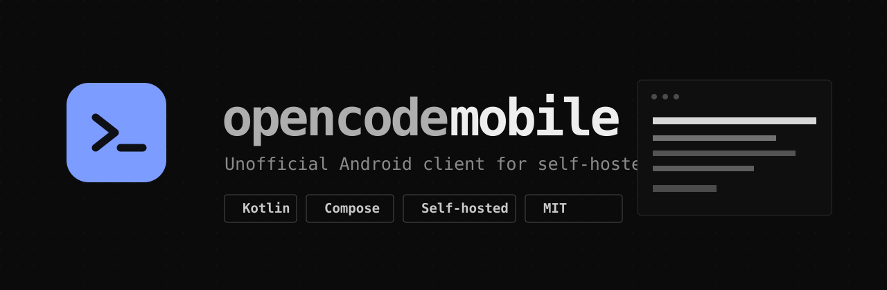
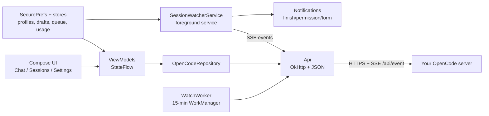

<p align="center">
  
</p>

<p align="center">
  <a href="https://github.com/michaelatamuk/opencode-mobile/actions/workflows/build.yml"></a>
  <a href="https://github.com/michaelatamuk/opencode-mobile/releases/latest"></a>
  <a href="LICENSE"></a>
  
  
</p>

<p align="center">
  <a href="https://opencode.ai">
    <picture>
      <source media="(prefers-color-scheme: dark)" srcset="docs/brand/opencode-works-with-dark.svg">
      
    </picture>
  </a>
</p>

# opencode mobile

A native Android client for a **self-hosted [OpenCode](https://opencode.ai) server** —
the same sessions as the TUI, on your phone, with no cloud service in between.

`Android 8.0+` · `Kotlin 2.0` · `Jetpack Compose` · `Material 3` · `targetSdk 36` · `MIT`

[**Download the latest APK**](https://github.com/michaelatamuk/opencode-mobile/releases/latest)
· [Server API notes](docs/server-api-notes.md) · [Report an issue](https://github.com/michaelatamuk/opencode-mobile/issues)

> **Unofficial client.** Not affiliated with, endorsed by, or supported by
> OpenCode / Anomaly. OpenCode itself is MIT-licensed; this project is an
> independent Android front end for its HTTP API.

---

## Who this is for

- **OpenCode users** who run a server on a laptop/desktop and want to read, steer
  and approve it from a phone — on the same Wi-Fi or through the OpenTunnel URL.
- **Contributors** who want to improve the Android client; start with the
  [architecture](#architecture), [invariants](#invariants-do-not-break) and
  [build](#build--test) sections.
- **Maintainers / AI agents** who need the API quirks and release process in one
  place: [`docs/server-api-notes.md`](docs/server-api-notes.md).

The phone talks HTTPS/SSE directly to your server. There is no proxy, account or
third-party backend.

## Install

1. Download `opencode-mobile-v*.apk` from [Releases](https://github.com/michaelatamuk/opencode-mobile/releases).
2. Allow installs from the browser/file manager on the device.
3. Open the app and connect:
   - **Pairing code / QR** — run `opencode pair` and paste the code or scan its QR.
   - **Manual** — server URL + password (username is always `opencode`).
     LAN: `http://<your-ip>:28894` · remote: your tunnel URL.
4. Enable **Settings → Notifications → Background notifications** and allow
   notifications. Pick *Only on finish* (default) or *Always*.
5. Optional: Settings → Security for biometric lock and screenshot blocking.

Samsung devices may need Auto Blocker / Play Protect disabled for sideloading.

## What it does

| Area | Highlights |
|---|---|
| **Sessions** | Bottom-right create button, sticky day headers, full-width titles with project/preview meta, reserved unread gutter, subagent chevron, live running cards with Stop, swipe-to-delete, pull-to-refresh. |
| **Chat** | Streaming SSE with reconnect, markdown/tables/code copy, clickable links, images and files (≤8 MB), agent forms, permissions, queued/steered messages with edit/steer/cancel, in-session search, pagination, jump-to-latest, drafts that survive leaving the screen. |
| **Agent activity** | One block per assistant turn (`Working 10m 07s · Shell` / `Worked 2m 05s · 9 steps`) with Stop in place, expandable to a step timeline with tool icons, file names and per-step input/output. |
| **Reviews** | Diff sheet with per-file stats, collapsed patches, branch/provider from VCS, file viewer, validated per-file revert (all-or-nothing), conversation fallback when the project has no git diff. |
| **Sessions as branches** | Branch a session, branch before a message, undo the last turn, compact context, A/B replay on another model with a word-level diff (two columns on wide screens). |
| **Models & cost** | Model/agent sheet with tabs: model list first, grouped by server-enabled provider, with search and a `current` marker; agents as described rows; session tokens/context/compact at the bottom. Per-session cost, context meter, daily/monthly budgets, 180-day history, CSV export. |
| **Notifications** | Foreground watcher driven by server events; finish-only mode is silent while working; progress/elapsed mode; inline reply; Continue / Explain / Retry actions (editable); permissions/forms; watchdog; per-session and per-project mute; WorkManager catch-up. |
| **Automation** | Schedules (interval/cron/at, optional run limit and shell `if`), shell runner with output, offline prompt queue with attachments, presets. |
| **Connections** | Named server profiles (with theme/watchdog/budget defaults), fallback URL, pairing, MCP servers+resources, integration search with API-key linking. |
| **Platform** | Widget (running titles, stop action, last updated), quick-settings tile, launcher shortcuts, `opencode://session/<id>` deep links, share target, EN/RU. |

### Deliberate design choices

- **No empty sessions** — a draft is created only on first send.
- **One primary composer action** — Mic when empty, Send when typed, Stop when a run is active.
- **Subagents stay under their parent** — root sessions only by default; enable
  Settings → Appearance → *Subagent runs* to nest and expand child runs. Child
  completions never notify.
- **Finish-only means silent** — Android still needs a foreground service to
  watch in the background, so finish-only keeps a minimized, soundless
  placeholder in the silent notification group (no status-bar icon) and only
  alerts when a turn stops.

## Configure

Authentication is HTTP Basic `opencode:<password>`. The app never sends the
password anywhere except your server. It requires an OpenCode server exposing
the V2 HTTP/SSE API (`/api/...`); older V1 servers will not work.

- **Profiles** hold server URL, password, fallback URL, theme, notification mode,
  watchdog, budgets and default agent/model. Switching a profile applies all of it.
- **Fallback URL** is tried automatically when the primary stops answering
  (e.g. LAN at home, tunnel outside).
- **Server features** used by some screens are gated by the server config:
  `experimental.schedules`, `experimental.artifacts` (disabled => no gallery),
  and MCP servers for the Connections page.

## Working on this repo

If you are a new maintainer or an AI coding agent, read in this order:

1. **Invariants** below — these encode bugs already fixed once.
2. [`docs/server-api-notes.md`](docs/server-api-notes.md) — real event names and endpoint quirks.
3. `Api.kt` and `OpenCodeRepository.kt` — the only network layer.
4. Run `./gradlew testReleaseUnitTest` before touching `DiffRevert` or parsing.

Do not add a second send/stop control, an ongoing notification in finish-only
mode, or a cursor query with `order`.

## Architecture



- **Single module** `app`, Compose-only UI.
- `Api` is the only HTTP layer; `OpenCodeRepository` adds reconnect/backoff.
- State is `StateFlow` in ViewModels; long-lived work uses `AppScope`.
- The watcher reacts to `session.status`, `session.execution.*`,
  `session.tool.*`, `session.idle`, `permission.asked`, `form.created`.
- Local persistence: `SecurePrefs` (keystore-backed), `ProfileStore`, `DraftStore`,
  `PendingStore`, `UsageStore`, `SeenStore`, `PinnedStore`, `SessionCache`.

### Project map

```
app/src/main/java/com/opencode/mobile/
  Api.kt                     HTTP + SSE client, models
  OpenCodeRepository.kt      domain wrapper, retry policy
  ChatViewModel.kt           chat state, send/fork/revert/compact
  SessionListViewModel.kt    list, archive, previews, usage
  SessionWatcherService.kt   foreground watcher + notifications
  WatchWorker.kt             15-minute safety net
  SecurePrefs.kt             encrypted preferences
  ProfileStore / DraftStore / PendingStore / UsageStore / SeenStore
  ui/                        ChatScreen, SessionListScreen, SettingsScreen,
                             Composer, Components, Theme, WordDiff
docs/server-api-notes.md     verified endpoint/event shapes and gotchas
```

## Build & test

Requirements: **JDK 17**, **Android SDK 36**, `local.properties` with
`sdk.dir=...` (git-ignored).

```sh
./gradlew assembleDebug        # app/build/outputs/apk/debug/app-debug.apk
./gradlew testReleaseUnitTest  # DiffRevert + message/error unit tests
```

Release signing uses env vars (CI supplies them from repository secrets):
`OPENCODE_KEYSTORE`, `OPENCODE_STORE_PASSWORD`, `OPENCODE_KEY_ALIAS`,
`OPENCODE_KEY_PASSWORD`. The signing key is stable across releases so updates
install over each other.

### Release process

1. Tag `v*` (for example `v0.27.0`) and push the tag.
2. CI (`.github/workflows/build.yml`) builds `assembleRelease`, passes the run
   number as `appVersionCode` and the tag as `appVersionName`, signs with the
   stable key, uploads the artifact and publishes a GitHub Release with
   `opencode-mobile-<tag>.apk`.
3. Verify the release page: APK size and the same signing key as previous builds.

## Invariants (do not break)

1. **One composer primary action**; never add a second send/stop/mic button.
2. **No empty sessions**; drafts are created on first send.
3. Unread = `session.updated > lastSeen`; mark seen on open and on new messages.
4. Finish-only must not post a visible or audible ongoing notification; it may
   keep only the silent foreground placeholder Android requires.
5. Child/subagent completions must not notify; the parent does.
6. Cursor pagination must not send `order` (server returns `InvalidCursorError`).
7. Row backgrounds must be opaque or swipe reveal shows through.
8. Credentials live in `SecurePrefs`; never log or export them
   (diagnostics export excludes the password).
9. Server-reported cost is authoritative; providers without cost config show `$0`.
10. `targetSdk 36` / SDK 36 is required by CI; don't bump dependencies blindly.

## Security & privacy

- Direct connection to your server; no third-party backend, no analytics, no telemetry.
- Password and server profiles live in keystore-backed encrypted preferences.
- Optional biometric lock and `FLAG_SECURE` screenshot/recents blocking.
- Diagnostics export contains device/server/watcher/theme state — **never the password**.
- Debug builds and release builds use the same package; the release key is stable
  so upgrades install over each other.

## Troubleshooting

| Symptom | Cause |
|---|---|
| `$0.00` cost | The provider has no `cost` block on the server (e.g. `deepseek-site-toga2`); the app displays the server value. |
| Session shows “running” but nothing happens | The server still reports it in `/api/session/active`; open it or Stop it from the row. |
| No notification while a turn runs | Expected in *Only on finish*; switch to *Always* for progress. |
| No finished notification | Check that the watcher switch is on and notifications are allowed; a chat left open used to swallow them while the app was in the background (fixed in 0.31). |
| Install fails over the old app | Different signing key or Play Protect/Auto Blocker blocking sideload. |
| Schedules/connections empty or forbidden | Server feature flag (`experimental.schedules`) or no MCP servers configured. |

## Limitations

- **Server-bound:** no artifact gallery when `experimental.artifacts` is disabled;
  true PTY (connect-token rejects non-browser clients) and OAuth provider login
  (server callback is `localhost` on the server machine); no inbox reordering.
- **R8/minify is off** until a shrunk build can be verified on a device.
- **Schedules** need `experimental.schedules`; no `until`/timezone or in-place edit.
- **Per-file revert** is text-only and refuses patches that no longer match.
- **Dependency bump** is pending; Compose BOM is pinned to a verified set.
- **Notifications** depend on the OS keeping the watcher alive; finish-only has
  a ≤15-minute WorkManager safety net.

## Documentation

- [`docs/server-api-notes.md`](docs/server-api-notes.md) — verified event names,
  endpoints, cursor/revert/fork semantics, revert stage→commit→clear behavior.

## Contributing

- **Issues**: include app version, Android version/device, server version, and
  the exact screen + steps. Diagnostics: Settings → About → *Export diagnostics*
  (no credentials).
- **Pull requests**: keep the composer to one primary action, keep finish-only
  silent, and run `./gradlew testReleaseUnitTest` before opening.
- This is an independent client; do not copy OpenCode brand assets into new
  places. “Works with OpenCode” is a statement of compatibility, not affiliation.

## License

MIT — see [LICENSE](LICENSE). OpenCode itself is a separate MIT-licensed project
by Anomaly; this repository contains none of its source or brand assets.
