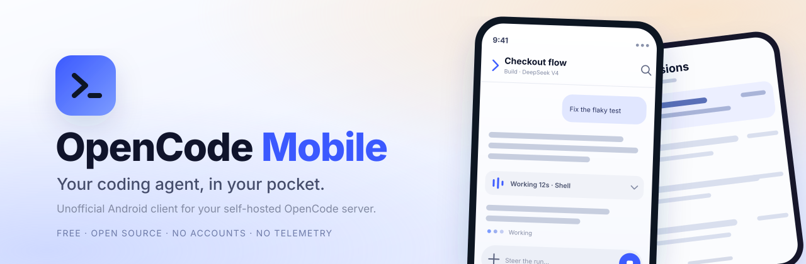
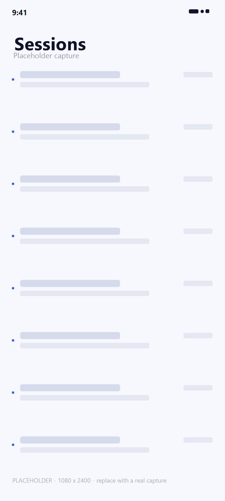
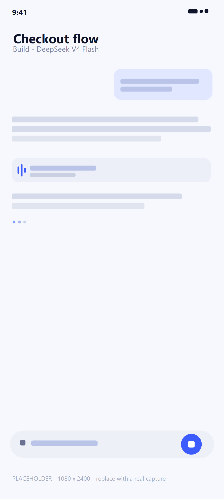
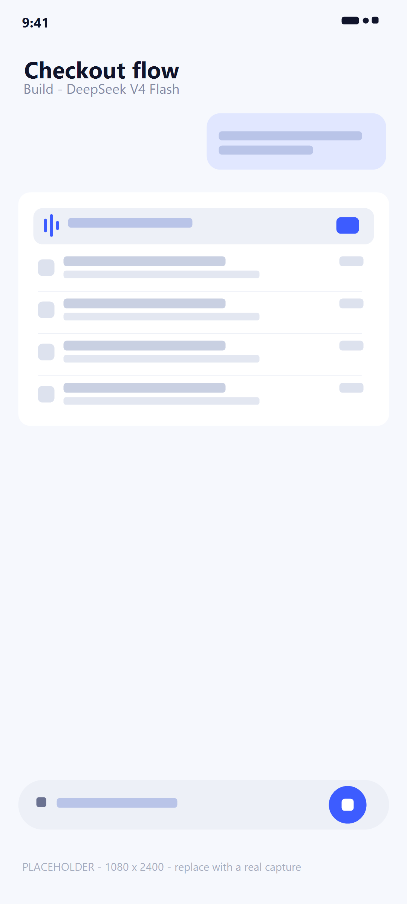
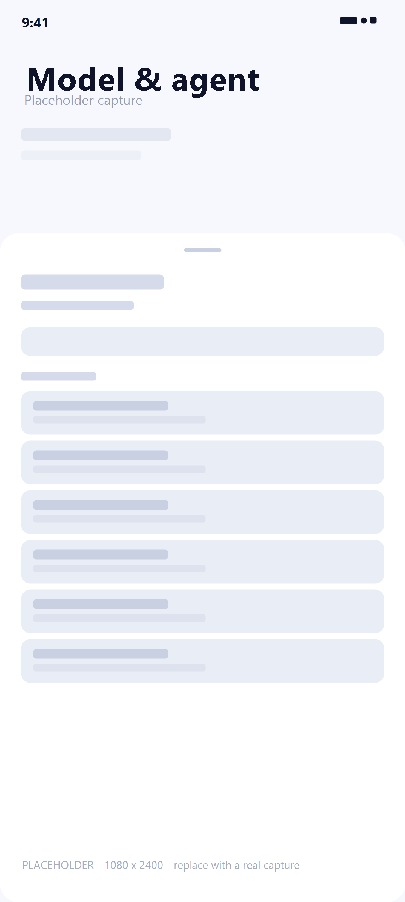
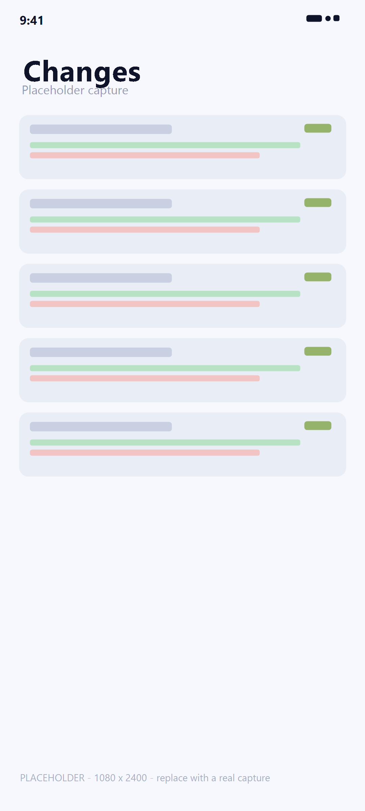
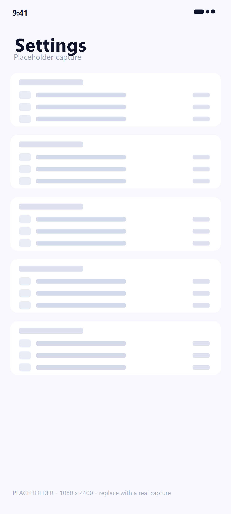

<p align="center">
  <picture>
    <source media="(prefers-color-scheme: dark)" srcset="docs/banner-dark.svg">
    
  </picture>
</p>

<p align="center">
  <a href="https://github.com/michaelatamuk/opencode-mobile/actions/workflows/build.yml"></a>
  <a href="https://github.com/michaelatamuk/opencode-mobile/releases/latest"></a>
  <a href="LICENSE"></a>
  
</p>

<p align="center">
  <a href="https://opencode.ai">
    <picture>
      <source media="(prefers-color-scheme: dark)" srcset="docs/brand/opencode-works-with-dark.svg">
      
    </picture>
  </a>
</p>

<h1 align="center">OpenCode Mobile</h1>

<p align="center">
  <b>Your coding agent, in your pocket.</b><br>
  A native Android client for a self-hosted <a href="https://opencode.ai">OpenCode</a> server —
  the same sessions as the TUI, with no cloud service in between.
</p>

<p align="center">
  <a href="https://github.com/michaelatamuk/opencode-mobile/releases/latest"><b>Download the latest APK</b></a>
  · <a href="#screenshots">Screenshots</a>
  · <a href="docs/server-api-notes.md">API notes</a>
  · <a href="https://github.com/michaelatamuk/opencode-mobile/issues">Report an issue</a>
</p>

> **Unofficial client.** Not affiliated with, endorsed by, or supported by
> OpenCode or Anomaly. OpenCode is MIT-licensed; this is an independent Android
> front end for its HTTP API.

---

## Screenshots

<table>
  <tr>
    <td align="center"><br><sub><b>Sessions</b><br>day groups, live runs</sub></td>
    <td align="center"><br><sub><b>Chat</b><br>streaming answers</sub></td>
    <td align="center"><br><sub><b>Step timeline</b><br>tools and thoughts</sub></td>
  </tr>
  <tr>
    <td align="center"><br><sub><b>Model &amp; agent</b><br>your enabled providers</sub></td>
    <td align="center"><br><sub><b>Changes</b><br>diff review</sub></td>
    <td align="center"><br><sub><b>Settings</b><br>profiles and security</sub></td>
  </tr>
</table>

<p align="center"><sub>Captures use demo data. UI in English and Russian.</sub></p>

## Install

1. Download `opencode-mobile-v*.apk` from [Releases](https://github.com/michaelatamuk/opencode-mobile/releases/latest).
2. Allow installs from your browser or file manager when prompted.
3. Open the app and connect:
   - **Pairing code / QR** — run `opencode pair` on the server and paste the code or scan the QR.
   - **Manual** — server URL plus password (the username is always `opencode`).
     LAN: `http://<your-ip>:28894` · remote: your tunnel URL.
4. Turn on **Settings → Notifications → Background notifications** and allow
   notifications. Choose *Only on finish* (default) or *Always*.
5. Optional: **Settings → Security** for biometric lock and screenshot blocking.

Samsung devices may need Auto Blocker or Play Protect disabled to sideload.

## What it does

- **Watch it work.** Runs, permissions and forms arrive as they happen. Steps
  stay where they happened as light `Used 2 Write, Shell` lines — tap one to see
  each tool's input and output — and a single live line above the composer carries
  the timer and the stop control.
- **Mission Control.** Every running session as a live tile — clock, current
  line, stop — instead of a list you have to scroll through. A finished run can
  be shared as a card.
- **Steer without switching.** Type while a turn runs to steer it, queue
  messages, or reply straight from the notification.
- **Approve from the lock screen.** Permission requests and agent forms show up
  as notifications with inline actions.
- **Review before you trust.** A diff sheet with per-file stats, a file viewer,
  and a validated per-file revert.
- **Branch, undo, compact.** Branch a session or a single message, undo the last
  turn, compact the context, or replay the same prompt on another model with a
  word-level comparison.
- **Keep an eye on spend.** Tokens, context meter, per-session cost, daily and
  monthly budgets, 180 days of history and CSV export.
- **Only the models you actually have.** The picker lists providers enabled on
  your server, grouped and searchable — not a public catalog.
- **Your server, your phone.** Named profiles with a fallback URL for LAN/tunnel,
  biometric lock, blocked screenshots, and no accounts or telemetry.
- **Small things that matter.** Widget, quick-settings tile, launcher shortcuts,
  `opencode://session/<id>` deep links, share target, English and Russian.

### Deliberate choices

- **No empty sessions** — a draft becomes a session on first send.
- **One primary composer action** — Mic when empty, Send when typed, Stop while a
  run is active; the same button morphs.
- **Subagents stay under their parent** — root sessions only by default; enable
  *Settings → Appearance → Subagent runs* to nest and expand child runs. Child
  runs never notify.
- **Finish-only stays quiet, but Android still shows the watcher.** Instant
  background alerts need a foreground service, and Android always displays that
  service's notification. In finish-only it is soundless, static, and never names
  a session; no channel setting can hide it. Turn *Background notifications* off
  if you prefer no entry at all — completions then rely on the periodic check.

## Requirements

- **Android 8.0+** (API 26).
- An OpenCode server exposing the **V2 HTTP/SSE API** (`/api/...`). Older V1
  servers will not work.
- The phone must reach the server: same Wi-Fi, or a tunnel URL.

## Configure

Authentication is HTTP Basic `opencode:<password>`. The password is only ever
sent to your own server.

- **Profiles** store server URL, password, fallback URL, theme, notification mode,
  watchdog and budgets. Switching a profile applies all of it.
- **Fallback URL** is tried automatically when the primary stops answering (LAN
  at home, tunnel outside, for example).
- **Server feature gates:** some screens depend on server config —
  `experimental.schedules` for schedules, `experimental.artifacts` for the
  artifact gallery, MCP servers for the Connections page.

## Security & privacy

- Direct connection to your server. No third-party backend, no analytics, no telemetry.
- Server URL and password live in keystore-backed encrypted preferences.
- Optional biometric lock and `FLAG_SECURE` screenshot/recents blocking.
- Diagnostics export contains device, server and watcher state — never the password.
- Debug and release builds share a package name; the signing key is stable, so
  updates install over each other.

## Troubleshooting

| Symptom | Likely cause |
|---|---|
| Cost shows `$0.00` | The provider has no `cost` block on the server; the app shows exactly what the server reports. |
| A session says “running” but nothing happens | The server still lists it in `/api/session/active`. Open it and stop the run from the activity header. |
| No notification while a turn runs | Expected in *Only on finish* — the watcher stays silent until the turn stops. |
| A silent `OpenCode` entry appears in the shade | Android requires a notification for the foreground watcher. It is soundless and static and cannot be hidden while background watching is on. |
| No finished notification | Check the watcher switch, notification permission, and battery optimisation for the app. The 15-minute background check catches a missed run. |
| Install fails over the old app | Different signing key, or Play Protect / Auto Blocker blocking the sideload. |
| Schedules or Connections are empty | Server feature flag (`experimental.schedules`) or no MCP servers configured. |

## Limitations

- **Server-bound:** no true PTY (the connect-token endpoint rejects non-browser
  clients), no OAuth provider login (the callback is `localhost` on the server
  machine), and no artifact gallery while `experimental.artifacts` is disabled.
- **Notification timing** depends on Android keeping the foreground watcher
  alive; aggressive battery savers can delay it up to the 15-minute check.
- **Schedules** need `experimental.schedules`; no timezone or in-place editing.
- **Per-file revert** is text-only and refuses patches that no longer match.
- **No inbox reordering** of sessions beyond pinning and archive.

## Development

```sh
./gradlew assembleDebug         # debug APK
./gradlew testReleaseUnitTest   # unit tests
```

- Architecture, project map and invariants: [`docs/ARCHITECTURE.md`](docs/ARCHITECTURE.md).
- Verified endpoint/event shapes: [`docs/server-api-notes.md`](docs/server-api-notes.md).
- Build requirements: JDK 17 and Android SDK 36.

Release builds are produced by CI on a `v*` tag and signed with a stable key;
the full process is in [`ARCHITECTURE.md`](docs/ARCHITECTURE.md#release-process).

## Contributing

See [`CONTRIBUTING.md`](CONTRIBUTING.md). In short: keep one composer action,
keep finish-only silent, run `./gradlew testReleaseUnitTest`, and never commit
credentials or `local.properties`.

## License

MIT — see [`LICENSE`](LICENSE). OpenCode itself is a separate MIT-licensed
project by Anomaly; this repository contains none of its source or brand assets.
