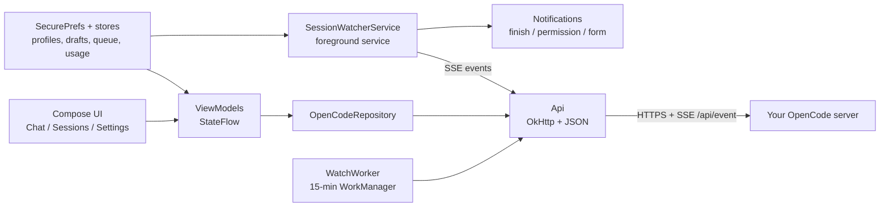

# Architecture

Single-module Android app (`app`), Jetpack Compose UI, no third-party backend.
This document is for maintainers; the user-facing README lives in
[`../README.md`](../README.md).

## Data flow



- `Api` is the only HTTP layer; `OpenCodeRepository` adds reconnect and backoff.
- State is `StateFlow` in ViewModels; long-lived work uses `AppScope`.
- The watcher reacts to `session.status`, `session.execution.*`,
  `session.tool.*`, `session.idle`, `permission.asked`, `form.created`.
- Verified event names and endpoint quirks: [`server-api-notes.md`](server-api-notes.md).

## Modules

- **`Api.kt`** — HTTP + SSE client, request/response models, message parsing.
- **`OpenCodeRepository.kt`** — domain wrapper, retry/fallback policy.
- **`ChatViewModel.kt`** — chat state, send/steer/fork/revert/compact.
- **`SessionListViewModel.kt`** — list, archive, previews, usage.
- **`SessionWatcherService.kt`** — foreground watcher and notifications.
- **`WatchWorker.kt`** — 15-minute WorkManager safety net.
- **`SecurePrefs.kt`** — keystore-backed preferences.
- **Stores** — `ProfileStore`, `DraftStore`, `PendingStore`, `UsageStore`,
  `SeenStore`, `PinnedStore`, `SessionCache`.
- **`ui/`** — `ChatScreen`, `SessionListScreen`, `SettingsScreen`, `Composer`,
  `Components`, `Theme`, `WordDiff`.

## Persistence

| Store | Contents |
|---|---|
| `SecurePrefs` | server URL, password, fallback URL, preferences |
| `ProfileStore` | named profiles + per-profile defaults (theme, watchdog, budgets, agent/model) |
| `DraftStore` | per-session composer drafts |
| `PendingStore` | prompts queued while offline, with attachments |
| `UsageStore` | spend history (180 days), budgets |
| `SeenStore` | last-seen marker per session (unread) |
| `PinnedStore` | pinned sessions |
| `SessionCache` | session list snapshot for cold start |

## Build & test

Requirements: **JDK 17**, **Android SDK 36**, `local.properties` with
`sdk.dir=...` (git-ignored).

```sh
./gradlew assembleDebug         # app/build/outputs/apk/debug/app-debug.apk
./gradlew testReleaseUnitTest   # DiffRevert + message parsing tests
```

Windows: use `gradlew.bat`.

Release signing uses env vars (CI supplies them from repository secrets):
`OPENCODE_KEYSTORE`, `OPENCODE_STORE_PASSWORD`, `OPENCODE_KEY_ALIAS`,
`OPENCODE_KEY_PASSWORD`. The key is stable across releases so updates install
over each other.

## Release process

1. Tag `v*` (for example `v0.33.3`) and push the tag.
2. CI (`.github/workflows/build.yml`) runs `assembleRelease`, passes the run
   number as `appVersionCode` and the tag as `appVersionName`, signs with the
   stable key, uploads the artifact and publishes a GitHub Release with
   `opencode-mobile-<tag>.apk`.
3. Verify the release page: APK size, version code increased, same signing key.

## Invariants (do not break)

1. **One composer primary action**; never add a second send/stop/mic button.
2. **No empty sessions**; drafts are created on first send.
3. Unread = `session.updated > lastSeen`; mark seen on open and on new messages.
4. Finish-only must never make a sound or mirror live run state. Android promotes
   any foreground-service notification to at least LOW, so the placeholder is
   shown; it must stay static, unnamed, and silent.
5. Child/subagent completions must not notify; the parent does.
6. Cursor pagination must not send `order` (server returns `InvalidCursorError`).
7. Row backgrounds must be opaque or the swipe reveal shows through.
8. Credentials live in `SecurePrefs`; never log or export them (diagnostics
   export excludes the password).
9. Server-reported cost is authoritative; providers without a cost block show `$0`.
10. `targetSdk 36` / SDK 36 is required by CI; don't bump dependencies blindly.
11. Steps are reported **inline, in the order they happened** (`Used 2 Write,
    Shell`); never hoist a turn's tools to one block above its text.
12. The only live indicator is the strip above the composer. It is an overlay
    over reserved list padding, so showing or hiding it must never resize the
    transcript.
13. Chat scroll positions use **lazy block** indices, never message indices: one
    block can hold a whole turn of messages, and mixing the two silently stops
    follow-the-run and jumps to the wrong place when older pages load.
